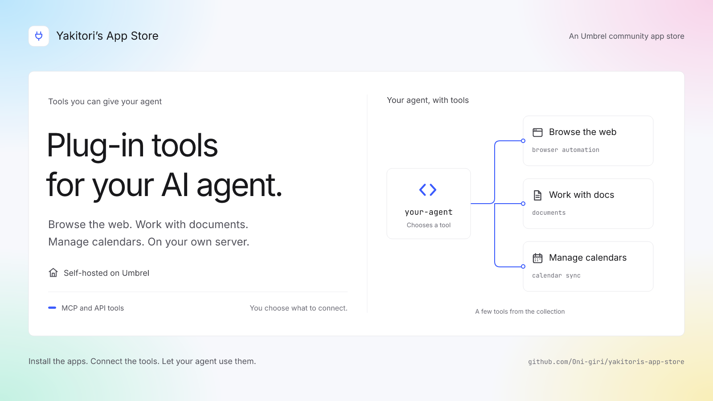

# Yakitori's Umbrel App Store



Self-hosted apps for people and AI agents on [umbrelOS](https://umbrel.com/).

## Add to Umbrel

1. Open the **App Store** on your Umbrel.
2. Click the **`···`** menu in the top-right corner and choose **Community App Stores**.
3. Paste this repository URL and click **Add**:

```text
https://github.com/Oni-giri/yakitoris-app-store
```

## Included Apps

| App | ID | Category | Port | Arch | Summary |
| --- | --- | --- | --- | --- | --- |
| [Act-CI](https://github.com/Oni-giri/act-ci) | `yakitori-act-ci` | Developer | `8755` | `amd64`, `arm64` | Self-hosted GitHub Actions CI powered by `nektos/act` with isolated DinD, REST API, and MCP server |
| [Aldine](https://github.com/trahloff/Aldine) | `yakitori-aldine` | Files | `8480` (HTTPS) | `amd64`, `arm64` | Collaborative LaTeX editor with git branches, Zotero, a sandboxed TeX Live compiler, and a built-in MCP server |
| [Anki Sync Hub](https://github.com/Oni-giri/anki-sync-hub) | `yakitori-anki-sync-hub` | Automation | `8723` | `amd64`, `arm64` | Private Anki sync service with a browser admin UI, REST API, and scoped MCP server |
| [ARTEX](https://github.com/BaaRai/ARTEX) | `yakitori-artex` | Developer | `8787` | `amd64` | Autonomous multi-agent penetration testing platform with evidence-bound findings |
| [BrowserPier](https://github.com/Oni-giri/browser-pier) | `yakitori-browserpier` | Developer | `7436` (`+7438` WebRTC) | `amd64` | Persistent Chromium browser profiles your AI agents can borrow via CDP, REST, or MCP |
| [Chartbrew](https://github.com/chartbrew/chartbrew) | `yakitori-chartbrew` | Developer | `4018` (HTTPS) | `amd64`, `arm64` | Live dashboards and reports from SQL/NoSQL databases and APIs, with an AI assistant, Data API, and MCP server |
| [ChartDB](https://github.com/chartdb/chartdb) | `yakitori-chartdb` | Developer | `8754` (HTTPS) | `amd64`, `arm64` | Browser-based ER database diagram editor with Smart Query, SQL DDL, and DBML import/export |
| [DailyHub](https://github.com/baselhusam/daily-hub) | `yakitori-daily-hub` | Files | `8771` | `amd64`, `arm64` | Personal command center for projects, tasks, and daily habits, with a built-in MCP server |
| [DeepSeek Harness](https://github.com/deepseek-ai/deepseek-harness) | `yakitori-deepseek-harness` | AI | `8734` | `amd64`, `arm64` | DeepSeek's open-source agent harness in your browser with local workspace storage |
| [Doop](https://github.com/kgoedecke/doop) | `yakitori-doop` | Files | `4400` | `amd64` | Multiplayer real-time design canvas for humans and AI agents with built-in MCP |
| [EdenText](https://github.com/stffnb/edentext) | `yakitori-edentext` | Files | `8748` (HTTPS) | `amd64`, `arm64` | Local-first browser word processor for `.docx` and `.odt` with optional AI and dictation proxies |
| [GlitchTip](https://gitlab.com/glitchtip/glitchtip-backend) | `yakitori-glitchtip` | Developer | `8476` (HTTPS) | `amd64`, `arm64` | Sentry-compatible error tracking, performance, OTLP logs, and uptime monitoring with a built-in MCP server |
| [Infisical](https://github.com/Infisical/infisical) | `yakitori-infisical` | Developer | `8311` (HTTPS) | `amd64`, `arm64` | Self-hosted secrets, internal PKI, KMS, and machine/agent credential vault |
| [It's a Plan](https://github.com/croffasia/itsaplan) | `yakitori-itsaplan` | Files | `8743` (HTTPS) | `amd64`, `arm64` | Self-hosted issue tracker, docs, boards, and workflows for teams and AI agents |
| [Keeper.sh](https://github.com/ridafkih/keeper.sh) | `yakitori-keeper` | Automation | `8792` (HTTPS) | `amd64`, `arm64` | Sync Google, Outlook, iCloud, Fastmail, CalDAV, and ICS calendars into each other, with iCal feeds, a REST API, and MCP for agents |
| [Maxun](https://github.com/getmaxun/maxun) | `yakitori-maxun` | Developer | `8767` (HTTPS) | `amd64`, `arm64` | No-code and AI web scraping, crawling, and extraction robots with a REST API, SDKs, and MCP server |
| [mcpspan](https://github.com/mcpspan/mcpspan) | `yakitori-mcpspan` | Developer | `6270` (HTTPS) | `amd64`, `arm64` | Self-hosted analytics for MCP servers: tool calls by client, latency, failures, sessions, releases, alerts, and a read-only MCP server |
| [Octop](https://github.com/TencentCloud/Octop) | `yakitori-octop` | AI | `8105` | `amd64`, `arm64` | Multi-user, multi-agent AI assistant with web dashboard, IM channels, RAG, and cron |
| [Oxynote](https://github.com/oxynote/oxynote) | `yakitori-oxynote` | Developer | `8766` (HTTPS) | `amd64`, `arm64` | Engineering wiki with live Prometheus/Loki/SQL charts and logs, reviewable page drafts, and MCP for agents |
| [tirreno](https://github.com/tirrenotechnologies/tirreno) | `yakitori-tirreno` | Developer | `8585` | `amd64`, `arm64` | In-application security: event ingest over an API key, risk scoring, review queue, and audit trail |

## Notes

- **`manifestVersion: 2` / `2.0` apps** (`yakitori-act-ci`, `yakitori-aldine`, `yakitori-browserpier`, `yakitori-chartbrew`, `yakitori-chartdb`, `yakitori-daily-hub`, `yakitori-doop`, `yakitori-edentext`, `yakitori-glitchtip`, `yakitori-infisical`, `yakitori-itsaplan`, `yakitori-keeper`, `yakitori-maxun`, `yakitori-mcpspan`, `yakitori-oxynote`, `yakitori-tirreno`) require **umbrelOS 2.0 or newer**.
- **Image pinning:** Application and infrastructure images are pinned to release tags and `@sha256:...` digests for reproducible installs and updates.
